<!-- ☕ Header -->

  

  

  
  
  

 

<!-- 👋 About -->
<table>
<tr>
<td width="50%" valign="top">

### 🇺🇸 About me

- 🎓 3rd semester student, learning programming
- 🧪 Trying out different languages to find what I enjoy most
- 🤖 Vibe coder: I build most of my projects with **Claude**
- 🌱 Always learning something new, one project at a time
- ☕ Fun fact: I'm into specialty coffee

</td>
<td width="50%" valign="top">

### 🇲🇽 Sobre mí

- 🎓 Estudiante de 3er semestre, aprendiendo a programar
- 🧪 Probando distintos lenguajes para encontrar lo que más me gusta
- 🤖 Vibe coder: armo la mayoría de mis proyectos con **Claude**
- 🌱 Siempre aprendiendo algo nuevo, un proyecto a la vez
- ☕ Dato curioso: me encanta el café de especialidad

</td>
</tr>
</table>

<!-- 🔭 Projects -->
<h2 align="center">🔭 Projects · Proyectos</h2>

<table>
<tr>
<td width="50%" valign="top" align="center">

### [Koaly](https://github.com/YukioSnwoo/Koaly)

Multi-branch **point-of-sale & inventory** web app, with admin, manager and cashier roles. 
<i>Sistema web de punto de venta e inventario multi-sucursal, con roles de admin, gerente y cajero.</i>

</td>
<td width="50%" valign="top" align="center">

### [ÁGORA](https://github.com/ur1eh/Proyecto_Integrador-AGORA)

**Local marketplace** to buy & sell new or used items, matching people by state and city. 
<i>Plataforma de compraventa local de productos nuevos o usados, por estado y municipio.</i>

</td>
</tr>
</table>

<!-- 🛠️ Tech -->
<h2 align="center">🛠️ Tech · Tecnologías</h2>

<table align="center">
<tr>
<td align="center" width="33%" valign="top">
  <b>Comfortable with</b> <i>Lo que domino</i>  
  
</td>
<td align="center" width="34%" valign="top">
  <b>Have worked with</b> <i>Lo que he usado</i>  
  
</td>
<td align="center" width="33%" valign="top">
  <b>Tools</b> <i>Herramientas</i>  
   
  
</td>
</tr>
</table>

<!-- 📊 Stats (cards are generated daily by .github/workflows/profile-cards.yml) -->
<h2 align="center">📊 Stats</h2>

  
  

  

<!-- 🐍 Snake: eats the contribution graph, navy edition -->

  <picture>
    <source media="(prefers-color-scheme: dark)" srcset="https://raw.githubusercontent.com/ur1eh/ur1eh/main/profile/snake-dark.svg" />
    <source media="(prefers-color-scheme: light)" srcset="https://raw.githubusercontent.com/ur1eh/ur1eh/main/profile/snake.svg" />
    
  </picture>

<i>☕ Fueled by specialty coffee & curiosity · Hecho con café de especialidad y curiosidad</i>

<!-- Footer -->

